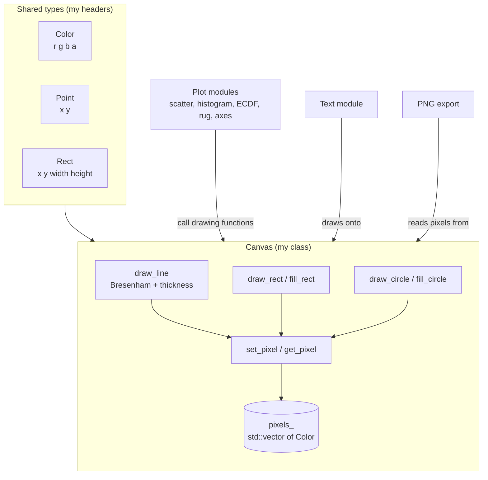

# Final Contribution and Technical Report: The Canvas Module

**Project:** vizlib, a C++ data visualization library (C++20)
**Group:** 7
**Author:** Nambalirwa Flavia Cate (Member 6, Rendering / Canvas)
**Registration number:** 25/U/0848
**Programme:** BELE
**Submission date:** 5 November 2026

---

## Table of Contents

1. [Project information](#1-project-information)
2. [Executive summary](#2-executive-summary)
3. [Introduction, role and scope](#3-introduction-role-and-scope)
4. [Module overview](#4-module-overview)
5. [Development history, Weeks 1 to 5](#5-development-history-weeks-1-to-5)
6. [Technical reader's guide](#6-technical-readers-guide)
7. [Object-oriented principles in the Canvas](#7-object-oriented-principles-in-the-canvas)
8. [Design decisions](#8-design-decisions)
9. [Testing and verification](#9-testing-and-verification)
10. [Build and workflow](#10-build-and-workflow)
11. [Example program and integration](#11-example-program-and-integration)
12. [Documentation and collaboration](#12-documentation-and-collaboration)
13. [AI-use declaration](#13-ai-use-declaration)
14. [Limitations and known gaps](#14-limitations-and-known-gaps)
15. [Personal reflection and lessons learned](#15-personal-reflection-and-lessons-learned)
16. [Conclusion](#16-conclusion)
17. [References](#17-references)
18. [Appendices](#18-appendices)

---

## 1. Project information

| Item | Detail |
|---|---|
| Library | vizlib, a C++ data visualization library that draws plots into an image |
| Language standard | C++20 (the project started on C++17 and the group changed it to C++20) |
| Build system | CMake |
| Test framework | doctest (`third_party/doctest.h`, `tests/test_main.cpp`) |
| Compiler used for my builds | GCC 13.3.0 in GitHub Codespaces |
| My role | Member 6: the Canvas, plus the shared types `Color`, `Point` and `Rect` |
| My branch for weeks 3 and 4 | `feature/canvas-drawing` |
| My earlier branch | `feature/canvas-headers` |
| Group workflow | Feature branches, pull requests, 3 approvals and passing CI before merge, no direct push to `main` |

**My files**

| File | Purpose |
|---|---|
| `include/vizlib/color.hpp` | `Color` (RGBA) |
| `include/vizlib/geometry.hpp` | `Point` and `Rect` |
| `include/vizlib/canvas.hpp` | `Canvas` class declaration |
| `src/canvas.cpp` | Canvas implementation |
| `tests/test_canvas.cpp` | 19 doctest test cases |
| `tests/CMakeLists.txt` | Registers `test_canvas.cpp` |
| `docs/canvas.md` | Module documentation |
| `examples/shapes_example.cpp` | Example drawing every shape |

---

## 2. Executive summary

The Canvas is the surface that every other drawing module in vizlib draws on. It is a grid of RGBA pixels held in memory. My module provides that grid, the shared types `Color`, `Point` and `Rect`, and the drawing operations other members need: single pixels, lines with a thickness, rectangle outlines and fills, and circle outlines and fills.

What I delivered:

- Three headers defining the shared types and the `Canvas` interface.
- An implementation in `src/canvas.cpp`: Bresenham's line algorithm, the midpoint circle algorithm, a row-scanning filled circle, filled and outlined rectangles, bounds-safe pixel access, and input validation.
- 19 test cases that built and passed in GitHub Codespaces (`100% tests passed, 0 tests failed out of 1`; the `1` is the single registered CTest program, not the number of test cases).

I want to be honest about the timeline. The headers were drafted on 9 October, after the group's 7 October interfaces deadline. The drawing implementation, the tests and the input-validation work (weeks 3 and 4 of the roadmap) were done between 27 and 31 October, later than my original roadmap planned. The module therefore reached its working state close to the code freeze. Section 5 explains this, and section 15 reflects on it.

I did not implement Xiaolin Wu's anti-aliased lines. It was optional in the plan, and I chose to improve the Bresenham version instead (section 8).

---

## 3. Introduction, role and scope

### 3.1 What the module is for

A plot is built from a small set of shapes. In my week 1 research note I listed where each shape is used:

- **Lines:** axes, ticks, gridlines, ECDF steps, rug ticks, and smooth curves built from many short lines.
- **Rectangles (outline and filled):** plot background, legend box, joint-plot panels, histogram bars.
- **Circles (outline and filled):** scatter-plot points.

Because everything reduces to these shapes, the Canvas only needs to do these well. Fewer shapes means less code to test, and a new plot type can reuse them.

### 3.2 Who depends on the Canvas

From the group plan and my research note:

| Member | Uses the Canvas for |
|---|---|
| Member 3 | ECDF and rug plots (lines) |
| Member 4 | Scatter, histogram and joint plots |
| Member 5 | Axes: `Rect` for the plot area, lines for axes and ticks |
| Member 7 | Reads the pixels to save a PNG |
| Member 8 | Draws text on top of the Canvas |
| Everyone | `Color`, `Point`, `Rect` |

### 3.3 What is in scope and out of scope

**In scope (mine):** the three headers, `src/canvas.cpp`, `tests/test_canvas.cpp`, the Canvas documentation and the shapes example.

**Not mine:** PNG writing (Member 7), text rendering (Member 8), the plot classes and the `Plot` base class hierarchy (Member 4 and others), and axes (Member 5). I describe how my module connects to them but I do not claim their work.

---

## 4. Module overview

### 4.1 Architecture



Every drawing function ends up calling `set_pixel`, except the filled shapes, which write to the vector inside loops whose limits are already clamped to the canvas. Section 6.5 and 6.7 give the details.

### 4.2 File map

```
vizlib/
├── include/vizlib/
│   ├── color.hpp        Color
│   ├── geometry.hpp     Point, Rect
│   └── canvas.hpp       Canvas class
├── src/
│   └── canvas.cpp       Canvas implementation
├── tests/
│   ├── test_canvas.cpp  19 test cases
│   └── CMakeLists.txt   registers the test file
├── docs/canvas.md
└── examples/shapes_example.cpp
```

### 4.3 Public interface

```cpp
namespace vizlib {
class Canvas {
private:
    int width_;
    int height_;
    std::vector<Color> pixels_;
public:
    Canvas(int width, int height, Color background);
    int width() const;
    int height() const;
    void set_pixel(int x, int y, Color c);
    Color get_pixel(int x, int y) const;
    void draw_line(Point from, Point to, Color c, int thickness = 1);
    void draw_rect(Rect r, Color c);
    void fill_rect(Rect r, Color c);
    void draw_circle(Point center, double radius, Color c);
    void fill_circle(Point center, double radius, Color c);
};
}
```

---

## 5. Development history, Weeks 1 to 5

### Week 1: Research (to 4 October)

**Objective.** Understand my module well enough to design it, and write the research note the group handed in for week 1.

**What I did.** I wrote a research note covering what the module does, how lines, circles, thick lines and clipping work, what I need from others, what others need from me, a week-by-week roadmap, and sources. I learned that Bresenham's algorithm draws a line with integer arithmetic, and that Wu's algorithm is a smoother variant that uses partial transparency on neighbouring pixels. I planned Bresenham first and Wu only if there was time.

**Reasoning.** I chose to keep the shape set small (lines, rectangles, circles) because every part of a plot can be built from them. I planned for bad input to throw `std::invalid_argument`, which was the group's agreed rule.

**Challenge.** The material was new: pixel grids, rasterising a diagonal line, and the idea that a "straight" line on screen is a staircase of pixels.

**Outcome.** A research note with 8 headings and a roadmap that ran through code freeze on 31 October.

**AI use (as declared in the note).** Claude and Gemini, to explain how the Canvas and the line, circle and clipping methods work, and to draft and tidy the note.

### Week 2: Shared types and the Canvas interface (5 to 11 October)

**Objective (roadmap).** Get the interfaces PR merged by 7 October, then implement `set_pixel`, `get_pixel`, Bresenham lines and rectangles with tests.

**What actually happened.** I did not meet the 7 October interfaces deadline. My git history shows I cloned the repository on 9 October and drafted the headers on the branch `feature/canvas-headers`. The week 2 report describes the headers as being in a pull request whose number I left blank (`#__`). I did not implement lines or rectangles that week.

**What I did.**

- Wrote `color.hpp`, `geometry.hpp` and `canvas.hpp`, each with `#pragma once` and inside `namespace vizlib`.
- `Color`: four `unsigned char` members, default opaque black.
- `Point` (`x`, `y`) and `Rect` (top-left `x`, `y`, plus `width`, `height`), both using `double`.
- `Canvas`: private `width_`, `height_`, and `std::vector<Color> pixels_`, with the public interface above.
- Studied DDA and Bresenham to understand the line algorithms.

**Reasoning, as I argued it in the week 2 report.**

- *Why structs:* `Color`, `Point` and `Rect` bundle values that always belong together. Without them a function such as `draw_rect` would take eight or more loose arguments (`x, y, width, height, r, g, b, a`), and it would be easy to swap their order.
- *Why the members are public:* these are plain data holders with no rule to protect. Any `x`, `y` or red value is valid, so letting other code set them cannot break anything.
- *Why `Canvas` is a class with private data:* it has a rule that must always hold, namely that the vector's size equals width times height. Private data forces all access through the public functions.
- *Why `set_pixel` ignores off-canvas points and `get_pixel` throws:* a line running partly off the edge is normal and should not crash. Reading a pixel that does not exist is a mistake the caller should learn about.
- *Why the index formula is hidden:* because the `y * width + x` formula is private, the storage could change later without breaking anyone's code.

**Challenges.**

- Choosing `int` or `double` for `Point` and `Rect`. I used `double`, and the group kept `double`.
- `get_pixel` throws `std::out_of_range`, but the group rule mentions `std::invalid_argument`. I flagged that I would agree one choice with the group. In my final code `get_pixel` throws `std::out_of_range`, while the constructor and the drawing functions throw `std::invalid_argument`. The group went with my choice.
- Understanding aliasing.

**AI use.** Claude explained pixels, the canvas layout, DDA, Bresenham and header versus source files, and reviewed my headers. It pointed out a spelling mistake in `Color`, an unclosed namespace and the constructor's initialisation order, which I then fixed. I typed the final code myself.

**A note on my week 2 report.** The submitted copy I have still contains leftover instruction text from a template ("Look at your group's plan and your own code to say exactly who uses it" and "If they have no member functions, say so in the report").

### Week 3: Drawing operations (roadmap 12 to 18 October; done 27 to 31 October)

**Objective (roadmap).** Circles, filled shapes, line thickness and clipping, with tests.

**What actually happened.** I did not start the week 3 and 4 implementation work until late October. The Week 4 roadmap also contained the 18 to 25 October period. Because the first part of that time passed without code being written, I compressed weeks 3 and 4 into 27 to 31 October, working with Claude and ChatGPT as I describe in the AI declaration. This was late relative to the plan, and it left little time for integration with other modules.

**What I implemented in `src/canvas.cpp`.**

1. The constructor, which throws `std::invalid_argument` for a width or height of 0 or less and then fills `pixels_` with the background colour.
2. `set_pixel` (ignores off-canvas positions) and `get_pixel` (throws `std::out_of_range`).
3. `draw_line` with Bresenham's algorithm and a thickness parameter.
4. `draw_rect` and `fill_rect`.
5. `draw_circle` (midpoint algorithm) and `fill_circle` (row scanning).

**Reasoning.**

- I followed the group's original decision to use Bresenham. While learning it I also found Wu's algorithm. I decided not to prioritise Wu, and to improve thickness, clipping and boundary handling of the existing Bresenham code instead. I said I would discuss it with my groupmates before deciding whether the library should include Wu at all, so that I would not build a redundant function. In the end Wu's algorithm was not used.
- A YouTube explanation of Bresenham (in Python) helped me understand the logic before I wrote it in C++.

**Challenges.**

- Understanding where the unnamed (anonymous) namespace should go. I thought it should come before `fill_rect`. In fact it should come before the first function that uses its helpers, and the Canvas member functions have to stay inside `namespace vizlib`.
- A first version of `canvas.cpp` closed the `vizlib` namespace too early and defined `fill_rect` twice. I removed the early closing brace and the duplicate.
- I could not build on my own computer because CMake is not installed on my Windows PC, so I built and tested in GitHub Codespaces.

**Verification.** I wrote the first set of tests, built in Codespaces with CMake and GCC, and ran `ctest --test-dir build --output-on-failure`. CTest reported the registered `vizlib_tests` program passed.

**Outcome.** The main drawing operations existed and the test program passed.

### Week 4: Robustness, clipping and edge cases (roadmap 19 to 25 October; done 27 to 31 October)

**Objective (roadmap).** Invalid-input and edge-case tests, and `docs/canvas.md`. Wu's algorithm only if time allowed.

**What I did.**

- **Input validation.** I added `check_coord`, which throws `std::invalid_argument` if a value is NaN, infinite, or has an absolute value above 1,000,000. The drawing functions apply it to their coordinates, sizes and radii. `draw_line` also rejects a thickness below 1 or above 1000.
- **Early rejection of invisible lines.** `draw_line` returns early when both endpoints lie beyond the same edge of the canvas (with padding equal to the thickness). This avoids walking a very long line that cannot touch the canvas.
- **Clamped loops.** `fill_rect` and `fill_circle` restrict their loops to the visible canvas, so an enormous off-canvas shape costs almost nothing. `fill_circle` uses `long long` for the radius-squared arithmetic to avoid integer overflow.
- **Empty rectangles.** `draw_rect` and `fill_rect` draw nothing if the width or height is 0 or less.
- **More tests.** I grew the test file to 19 test cases (section 9).

**Reasoning: empty rectangles.** I first questioned a line that threw an exception for a rectangle with zero size. I realised a value can legitimately be zero. For example, a histogram bar of height 0 is a valid bar, so throwing would stop the whole plot for a normal case. I chose to treat an empty rectangle as a no-op and to document it.

**Reasoning: rejecting versus clipping.** The early return in `draw_line` is a trivial reject, not a full clipping algorithm such as Cohen–Sutherland. A line that might cross the canvas is still walked by Bresenham, and off-canvas pixels are dropped by `set_pixel`. Exact clipping to the canvas boundary is possible future work. I chose to be precise about this in the report instead of calling it "clipping" without qualification.

**Challenges.**

1. *The first Codespaces build failed.* The new tests used `std::nan()` and `INFINITY` without `#include <cmath>`. I added the include in `tests/test_canvas.cpp`, rebuilt, and the build passed.
2. *I edited on the wrong branch.* I had made my edits while on `main` in Codespaces. I used `git stash push`, `git switch feature/canvas-drawing` and `git stash pop`, then confirmed the changes were on the feature branch.
3. *A review of my code found `fill_circle` did not call `check_coord`.* I added the missing checks and a test line for a `fill_circle` with NaN.
4. *`git diff --check` reported trailing whitespace* on two lines of `canvas.cpp`, which I removed.

**Verification.** Build succeeded with GCC 13.3.0. Result: `100% tests passed, 0 tests failed out of 1`.

**Outcome.** The Canvas handled bad input and off-canvas shapes without crashing.

### Week 5: Documentation, example and freeze (26 to 31 October; and up to 5 November)

**Objective (roadmap).** Example program, final docs, bug fixes and code freeze on 31 October.

**Status.**

| Item | Status |
|---|---|
| Public-function comments in `canvas.hpp` | Done |
| `docs/canvas.md` | Done and committed |
| `examples/shapes_example.cpp` | Done. It draws the shapes and saves a PNG using the group's PNG export, which is Member 7's work, not mine |
| README contribution paragraph | Done (typed by me) |
| Integration with other modules | Other modules call the Canvas functions, and full plots were drawn and saved |

**Outcome.** The Canvas was documented, had its example, and was used by other modules to draw complete plots.

---

## 6. Technical reader's guide

Each topic below has three parts: an **overview** (what and why), a **breakdown** (the steps in plain terms) and **technical detail** (the code and the reasoning).

### 6.1 `Color`, `Point` and `Rect`

**Overview.** Three small structs that every module shares, so all modules "speak the same language".

**Breakdown.**

| Type | Members | Meaning |
|---|---|---|
| `Color` | `r`, `g`, `b`, `a` (`unsigned char`, 0 to 255) | Red, green, blue and alpha. Alpha 255 is fully solid, 0 is invisible. Default is opaque black. |
| `Point` | `x`, `y` (`double`) | A position |
| `Rect` | `x`, `y`, `width`, `height` (`double`) | `x`, `y` is the **top-left corner**, plus a size |

**Technical detail.**

```cpp
struct Color { unsigned char r = 0, g = 0, b = 0, a = 255; };
struct Point { double x = 0, y = 0; };
struct Rect  { double x = 0, y = 0, width = 0, height = 0; };
```

- `unsigned char` is exactly one colour channel (0 to 255) and keeps a `Color` at 4 bytes.
- Default member values mean a `Color` never contains random leftover memory.
- The members are public because these types have no rule to protect (section 7.1). They have no member functions.
- `double` for `Point` and `Rect` lets other modules pass data coordinates directly. The Canvas converts to whole pixels itself with `std::lround`.

### 6.2 Canvas storage and the index formula

**Overview.** The picture is a grid of pixels, but it is stored as one flat list.

**Breakdown.** Pixels are stored row by row. The first `width` entries are the top row, the next `width` entries are the second row, and so on. Coordinates are 0-based, with (0, 0) at the top-left.

```
index = y * width + x
```

**Worked example.** A canvas 5 pixels wide and 3 tall (indices 0 to 14):

```
        x=0  x=1  x=2  x=3  x=4
y=0  [   0    1    2    3    4 ]
y=1  [   5    6    7    8    9 ]
y=2  [  10   11   12   13   14 ]
```

The pixel at (x=3, y=1) is at index 1 × 5 + 3 = **8**. The pixel at (x=0, y=2) is at 2 × 5 + 0 = **10**.

**Technical detail.**

- The constructor throws `std::invalid_argument` if `width <= 0` or `height <= 0`, then calls `pixels_.assign(width * height, background)`.
- The private vector means the rule "size equals width times height" cannot be broken from outside.
- The index formula is used in one place only (`set_pixel` / `get_pixel`, and the loops in the filled shapes), which is why changing the storage later would be cheap.

### 6.3 `set_pixel` and `get_pixel`

**Overview.** The two basic operations. Everything else is built on them.

**Breakdown.**

| Function | Off-canvas behaviour | Why |
|---|---|---|
| `set_pixel(x, y, c)` | Silently does nothing | A shape running partly off the edge is normal, and should not crash or write outside the vector |
| `get_pixel(x, y)` | Throws `std::out_of_range` | Reading a pixel that does not exist is a caller mistake |

**Technical detail.** Both check `0 <= x < width_` and `0 <= y < height_` before computing `y * width_ + x`. The asymmetry is deliberate and is the same one I argued in the week 2 report.

### 6.4 `draw_line`: Bresenham's algorithm

**Overview.** A screen cannot show a perfect diagonal, only pixels. Bresenham's algorithm walks from one end to the other and picks the pixel closest to the true line at each step, using only whole numbers (no floating point, no rounding).

**Breakdown.**

1. Check the thickness (1 to 1000) and all four coordinates (`check_coord`).
2. Round the endpoints to whole pixels with `std::lround`.
3. Reject early if the whole line is obviously off the canvas.
4. Walk the line. At each step, colour the current position, then decide whether to step in x, in y, or both, based on an error value.
5. Stop when the end point is reached.

**Technical detail.**

```cpp
int dx =  std::abs(x1 - x0);
int dy = -std::abs(y1 - y0);          // stored negative
int sx = (x0 < x1) ? 1 : -1;          // step direction in x
int sy = (y0 < y1) ? 1 : -1;          // step direction in y
int err = dx + dy;                    // the error term

while (true) {
    stamp(*this, x0, y0, thickness, c);
    if (x0 == x1 && y0 == y1) break;
    int e2 = 2 * err;
    if (e2 >= dy) { err += dy; x0 += sx; }   // step in x
    if (e2 <= dx) { err += dx; y0 += sy; }   // step in y
}
```

- `dy` is stored negative so the same code works in all octants. `err` tracks how far the pixels have drifted from the true line, and the two `if` tests choose a horizontal step, a vertical step or a diagonal step (both tests true).
- `e2 = 2 * err` keeps everything in integers.
- This is the form of the algorithm described in the Wikipedia article I listed as a source.

**Thickness.** A helper `stamp` draws a square of side `thickness` at each step:

```cpp
int half = thickness / 2;
for (int dy = 0; dy < thickness; ++dy)
    for (int dx = 0; dx < thickness; ++dx)
        canvas.set_pixel(x - half + dx, y - half + dy, c);
```

For an odd thickness the square is centred. For an **even** thickness it extends one extra pixel up and to the left, because `half` is rounded down. That is a known property, not a bug, but it means an even-thickness line is not perfectly centred on the true line.

**Default argument.** `thickness = 1` is in the declaration in the header only. C++ does not allow repeating a default argument in the definition. `draw_line(a, b, colour)` therefore draws a 1-pixel line.

**Cost.** About O(max(|dx|, |dy|) × thickness²).

**Early reject (trivial rejection).** With `pad = thickness`, the function returns without drawing if both ends are beyond the same edge:

```cpp
if ((x0 < -pad && x1 < -pad) || (x0 >= width_  + pad && x1 >= width_  + pad) ||
    (y0 < -pad && y1 < -pad) || (y0 >= height_ + pad && y1 >= height_ + pad))
    return;
```

This is **not** full clipping (section 6.8).

### 6.5 `draw_rect` and `fill_rect`

**Overview.** A rectangle outline is four lines. A filled rectangle is every pixel inside.

**Breakdown.**

- `draw_rect`: validate, ignore empty rectangles, then draw four 1-pixel lines for the top, bottom, left and right edges. The right and bottom edges are at `x + width - 1` and `y + height - 1`, so a rectangle of width `w` covers exactly `w` pixels across.
- `fill_rect`: validate, ignore empty rectangles, round the corners, **clamp** them to the canvas, then loop over the visible area and call `set_pixel`.

**Technical detail.**

```cpp
int x0 = std::max(0,       static_cast<int>(std::lround(r.x)));
int y0 = std::max(0,       static_cast<int>(std::lround(r.y)));
int x1 = std::min(width_,  static_cast<int>(std::lround(r.x + r.width)));
int y1 = std::min(height_, static_cast<int>(std::lround(r.y + r.height)));
```

`x1` and `y1` are exclusive, so the filled area is `[x0, x1) × [y0, y1)`. Clamping means cost is proportional to the visible area, not the requested area. A one-pixel rectangle (width and height 1) draws one pixel (tested).

`draw_rect` and `fill_rect` round the right edge differently (`x + width - 1` versus `lround(x + width)`). For fractional inputs these could in principle differ by a pixel. This is not tested for fractional values.

### 6.6 `draw_circle` and `fill_circle`

**Overview.** A circle is symmetric, so the algorithm computes one eighth of it and mirrors each point 8 ways.

**Breakdown, outline (midpoint algorithm).** Start at the top of the circle and step along, using an integer decision value to choose between two candidate pixels. Each computed point (x, y) is plotted at eight positions: (±x, ±y) and (±y, ±x), all offset by the centre.

**Breakdown, fill.** Go row by row. For a row `dy` pixels away from the centre, the half-width is √(r² − dy²). Colour from `cx − half` to `cx + half`.

**Technical detail.**

- `fill_circle` limits the rows to those on the canvas (`first = max(-r, -cy)`, `last = min(r, height_ - 1 - cy)`) and limits each row's span to `[0, width_ - 1]`.
- `rr = r * r` is held in `long long` so a large radius cannot overflow `int`.
- `half = lround(sqrt(rr - dy*dy))`.
- A negative radius throws `std::invalid_argument`. Radius 0 is allowed.
- The outline and the fill use different methods, so on the very edge pixel they can disagree by one pixel. This is not tested, so I do not claim they match exactly.
- Cost: outline O(r), fill O(visible area).

### 6.7 Validation and clipping together

**Overview.** Two separate safety mechanisms protect the Canvas.

| Mechanism | Purpose | Where |
|---|---|---|
| **Validation** | Reject nonsense input loudly | `check_coord`, thickness range, negative radius, constructor size |
| **Clipping** | Handle shapes that legitimately go off-canvas quietly | `set_pixel` bounds check, clamped loops, early line reject |

**Validation rules.**

| Input | Rule | Exception |
|---|---|---|
| Canvas width or height | Must be > 0 | `std::invalid_argument` |
| Any coordinate, size or radius | Finite and `|value| <= 1,000,000` | `std::invalid_argument` |
| Thickness | 1 to 1000 | `std::invalid_argument` |
| Radius | Not negative | `std::invalid_argument` |
| `get_pixel` off canvas | In range | `std::out_of_range` |
| Empty rectangle | **Not** an error: no-op | none |

**Why 1,000,000 and 1000?** They are limits I chose so values stay safely inside `int` after rounding and loops cannot run for an unreasonable time. They are practical limits, not mathematical ones.

**Clipping, precisely.**

1. `set_pixel` drops any off-canvas pixel. This alone makes everything memory-safe.
2. `fill_rect` and `fill_circle` clamp their loops, so huge off-canvas shapes are cheap.
3. `draw_line` skips lines wholly beyond one edge. A line that crosses the canvas from far outside is still walked pixel by pixel, which is correct but slower for extreme coordinates.

### 6.8 Rejection versus true clipping

A true line-clipping algorithm (for example Cohen–Sutherland) would compute where a line enters and leaves the canvas and walk only that part. I did not implement that. My early return only handles the easy case. I describe it as a **trivial reject plus safe pixel dropping**, not as full clipping.

---

## 7. Object-oriented principles in the Canvas

I state this the same way I did in week 3: all four principles are taught, but they do not all have to appear in every class.

| Principle | Used in Canvas? | Evidence |
|---|---|---|
| Encapsulation | **Yes** | `width_`, `height_`, `pixels_` are private. The invariant (size equals width × height) can only be changed through the constructor and public functions. |
| Abstraction | **Yes** | Other modules call `draw_line` or `fill_circle` without knowing Bresenham or the midpoint algorithm. They call `set_pixel` without knowing the index formula. |
| Inheritance | **No** | `Canvas` inherits from nothing, and nothing inherits from it. There is one concrete Canvas, and inheritance without a real need would add complexity. |
| Polymorphism | **No** | No virtual functions. The drawing functions are ordinary member functions. |

**What is not mine.** The wider project has a `Plot` base class with plot types such as `ScatterPlot` and `HistogramPlot`. That inheritance and polymorphism belong to other members. I do not count them as features of my module.

**Templates.** I wrote none. `std::vector<Color>` is a standard-library template that I use, but I did not define one. Pixel coordinates are always whole numbers and a colour is always 4 bytes, so a template would add nothing. The course text says to use "appropriate classes, functions, templates, or other C++ features", which I read as "use what is appropriate".

---

## 8. Design decisions

| # | Decision | Chosen | Alternative | Reason | Trade-off |
|---|---|---|---|---|---|
| 1 | Pixel storage | One flat `std::vector<Color>` | Vector of vectors | Single allocation, simple index formula, easy for the PNG exporter to read | Must remember `y * width + x` (hidden in private code) |
| 2 | Line algorithm | Bresenham | DDA; Wu (anti-aliased) | Integer-only, follows the group plan | Jagged diagonals |
| 3 | Wu's algorithm | Not implemented | Implement it | It was optional. Better to harden Bresenham first | No smooth lines |
| 4 | `Point` / `Rect` type | `double` | `int` | Other modules pass data coordinates | Needs rounding to pixels |
| 5 | `Color` channels | `unsigned char` | `int` or `float` | Exactly one 0 to 255 channel; 4 bytes per colour | Overflows are a caller's concern |
| 6 | Structs for data types | Public members | Private with getters | No rules to protect | No validation on the types themselves |
| 7 | `Canvas` data | Private | Public | The size invariant must hold | More function calls |
| 8 | `set_pixel` off canvas | Ignore | Throw | Shapes partly off canvas are normal | A caller's bad coordinates are hidden |
| 9 | `get_pixel` off canvas | Throw `out_of_range` | Return a default colour | A bad read is a mistake | Differs from the group rule's `invalid_argument` |
| 10 | Thick lines | Square stamp at each step | Parallel offset lines | Simple, no gaps | Even thickness is off-centre; corners are square |
| 11 | Empty rectangle | No-op | Throw | A zero-height bar is valid | Silent for accidental zero size |
| 12 | Huge or non-finite input | Throw | Clamp silently | Fail loudly for nonsense | Callers must catch or avoid |
| 13 | Off-canvas lines | Trivial reject + pixel dropping | Full Cohen–Sutherland clipping | Simpler, enough for this project | Long crossing lines are still walked |
| 14 | Circle fill | Row scan with `sqrt` | Fill with midpoint decisions | Easy to reason about | Edge may differ by one pixel from the outline |
| 15 | Transparency | Overwrite | Alpha blending | Out of the time available | Semi-transparent colours are not blended |
| 16 | Templates | None | Template the pixel type | Nothing to generalise | None for this project |
| 17 | Build location | GitHub Codespaces | Local build | CMake not installed on my PC | Needs internet |

**Which of these were my own decisions?** Decisions 1, 4 to 7 and 11 I argued myself in my reports. Decision 11 came from a question I raised about a `throw` line. For decisions 10 and 12 to 14 (thickness stamp, the numeric limits, trivial reject, `long long`), Claude proposed the code and I reviewed, entered and tested it. These were not unaided design choices.

---

## 9. Testing and verification

**Framework.** doctest, with `tests/test_main.cpp` providing `main`. The 19 test cases are in `tests/test_canvas.cpp`, which defines small helpers (`same()` to compare colours, and the colours `BG` and `RED`).

| # | Test case | What it checks | Area |
|---|---|---|---|
| 1 | set_pixel then get_pixel | Read back what was written | Pixel access |
| 2 | pixels off the canvas | `set_pixel` ignores, `get_pixel` throws | Pixel access, clipping |
| 3 | a canvas of size zero throws | Constructor validation | Validation |
| 4 | horizontal line | Expected pixels coloured | Lines |
| 5 | diagonal line | Expected pixels coloured | Lines |
| 6 | a line that runs off the canvas does not crash | Clipping | Lines |
| 7 | thickness below 1 throws | Validation | Lines |
| 8 | fill_rect | Interior filled | Rectangles |
| 9 | draw_rect is an outline only | Interior untouched | Rectangles |
| 10 | draw_circle is an outline only | Centre untouched | Circles |
| 11 | fill_circle is solid | Interior filled | Circles |
| 12 | a negative radius throws | Validation | Circles |
| 13 | fill_rect partly off the canvas is clipped | Clamped loops | Clipping |
| 14 | circles partly or fully off the canvas do not crash | Clipping | Clipping |
| 15 | NaN, infinity and huge values are rejected | `check_coord` (including `fill_circle` with NaN) | Validation |
| 16 | empty rectangles draw nothing | No-op behaviour | Edge case |
| 17 | one-pixel rectangle | Draws exactly one pixel | Edge case |
| 18 | rectangles with NaN are rejected | Validation | Validation |
| 19 | thick horizontal line covers rows above and below | Thickness | Lines |

**Results.** Build with GCC 13.3.0 in Codespaces. `ctest --test-dir build --output-on-failure` reported `100% tests passed, 0 tests failed out of 1`. The `1` counts registered CTest programs, not test cases.

**What is not tested (be honest here).**

- The early-reject path of `draw_line` has **no dedicated test**. We planned two tests (a line entirely outside draws nothing, and a long line from far outside still shows), but the final test file has 19 test cases and does not include them. They were not added.
- Even-thickness centring.
- Whether `draw_circle` and `fill_circle` agree on edge pixels.
- Fractional coordinate rounding in `draw_rect` versus `fill_rect`.
- Alpha values (there is no blending to test).
- Integration with the other modules.

**Verification beyond the tests.** I used `git diff --check` to find trailing whitespace, and I read my own code against my notes.

---

## 10. Build and workflow

### 10.1 Environment

I could not build on my own Windows PC because CMake was not installed there. I used **GitHub Codespaces**, a cloud development environment, which had GCC 13.3.0 and CMake. Builds, tests and Git work happened there.

### 10.2 GCC versus the C++ standard

These are two different things.

- **GCC 13.3.0** is the *compiler*, the program that turns code into an executable.
- **C++17 / C++20** are *language standards*, versions of the C++ rules the code follows. The project started on C++17 and the group changed it to C++20.

GCC 13 can compile several standards (C++17, C++20 and others). The compiler version does not decide which standard the project uses.

### 10.3 Commands

```bash
cmake -S . -B build                    # configure
cmake --build build                    # build
ctest --test-dir build --output-on-failure   # run tests
```

### 10.4 Git workflow

- I worked on feature branches: `feature/canvas-headers` (week 2) and `feature/canvas-drawing` (weeks 3 and 4).
- `main` is protected. A pull request needs **3 approvals** and passing **CI**.
- On 9 October my first commit failed with "Author identity unknown". I fixed it with `git config --global user.name` and `user.email`.
- I made edits on `main` in Codespaces by mistake, then moved them with `git stash push`, `git switch feature/canvas-drawing` and `git stash pop`.
- I ran `git diff --check` before committing to catch whitespace errors.
- Early on, running Git in the parent folder (`PROJECT.cpp`) instead of `vizlib` gave "not a git repository". I fixed it by changing into the project folder.

### 10.5 Pull requests and CI

My work went through the group workflow described above: feature branches and pull requests into the protected `main` branch.

---

## 11. Example program and integration

### 11.1 `shapes_example`

`examples/shapes_example.cpp` is a program that draws every shape and saves `data/output/shapes_example.png`. Writing the PNG is done by the group's PNG export, which was not my role.

Usage example from my documentation:

```cpp
#include <vizlib/canvas.hpp>

vizlib::Canvas canvas(400, 300, vizlib::Color{255, 255, 255, 255});  // white
canvas.draw_line({10, 10}, {390, 290}, vizlib::Color{0, 0, 0, 255}, 2);
canvas.fill_circle({200, 150}, 40, vizlib::Color{31, 119, 180, 255});
```

### 11.2 Integration with other modules

- Member 4's week 4 report said their plots used private helpers (`draw_segment`, `fill_box`, `draw_dot`) while waiting for my functions to be ready.
- Since then, other modules call my Canvas functions, and full plots were drawn. I cannot list every module that uses them, so I do not name them here.

---

## 12. Documentation and collaboration

### 12.1 Documentation

- Comments on the public functions in `canvas.hpp` (parameters, behaviour, exceptions).
- `docs/canvas.md` covers what the module does, how it works, why it is written this way, how it is tested, limitations and who changed what.
- The course says the **README must be hand-typed and not AI-generated**. I typed my README contribution paragraph myself. This report is not the README.

### 12.2 Collaboration

What I can state:

- I depended on the group plan for the module split, on the group's error-handling rule for exceptions, and on Members 4 and 7 for the usage and PNG-export signatures.
- My week 3 report said I would discuss Wu's algorithm with my groupmates In the end Wu's algorithm was not used..

What I do not claim: any work on other members' modules.

---

## 13. AI-use declaration

The course requires every AI use to be declared with the tool, the purpose and the reason, and warns that undeclared use will be penalised. This is the complete list. My weekly reports declared AI use in slightly different ways, so I have merged them here.

| Stage | Tool | Purpose | Reason |
|---|---|---|---|
| Week 1 research note | Claude, Gemini | Explain how the Canvas, lines, circles and clipping work; draft and tidy the note | To understand the topic before designing; to check against the group plan |
| Week 2 | Claude | Explained pixels, canvas layout, DDA, Bresenham, headers vs source files; reviewed my headers (spelling of `Color`, unclosed namespace, initialisation order) | To learn the concepts; I fixed the errors and typed the final code |
| Week 3 | ChatGPT, Claude | Explanations; shorter or better ways to implement parts; organising the report; formatting advice | To understand while coding; to present the report clearly |
| Weeks 3 and 4 code | Claude | Drafted code and tests for the drawing functions, validation, clipping and edge cases; reviewed my code (found the missing `check_coord` in `fill_circle`); explained Git steps | To learn and to finish under time pressure. I typed, built and tested the code in Codespaces and I must be able to explain it |
| Week 4 build and Git | ChatGPT | Interpreted build and test output (`<cmath>`, whitespace check); explained stash and branch steps; improved the report | To resolve errors |
| Week 05 | Claude |Helped me with tests  | To produce working code |

**What this means.** The algorithms and large parts of the code in weeks 3 and 4 were drafted with AI help, which I then typed, built, tested and reviewed. I can explain every function in section 6 in my own words and say which parts were suggested to me.

---

## 14. Limitations and known gaps

### 14.1 Limitations (by design or scope)

- **No anti-aliasing.** Diagonal lines and circle edges are jagged. Wu's algorithm was optional and not implemented.
- **No alpha blending.** A new colour replaces the old one. Alpha is stored but not used when drawing shapes.
- **No dashed lines and no polygons.**
- **Early rejection, not full clipping.**
- **Even-thickness lines are off-centre by one pixel.**
- **Outline and fill circles may differ by a pixel on the edge** (untested).
- **Numeric limits** (1,000,000 and 1000) are practical limits, not mathematically derived.

### 14.2 Gaps in the project and my process

These are not design limits. They are things I did not finish or test.

- The week 5 work started late and was compressed into November.
- Two planned tests of the early-reject path were not added.

---

## 15. Personal reflection and lessons learned

1. **Starting late costs more than the work itself.** I started the implementation work close to the freeze. The work was manageable once I began, but there was little room left for integration with the other members. If I did this again I would implement `set_pixel` and a plain line in week 2 so others could rely on them early.
2. **Understanding is slower than typing.** I asked for the code to be slowed down because I did not truly understand what the week 4 work was about. Writing the code step by step, and asking questions such as why `fill_rect` needs clamped loops, taught me more than receiving a full solution.
3. **Good questions improved the design.** Asking whether a zero value should really throw led to the empty-rectangle decision. Asking whether the project needed templates led to the honest answer "no".
4. **Be precise about what code does.** I first called the early return "clipping". I then wrote down that it is a trivial reject and not true clipping. Reviewing my own claims made the report more accurate.
5. **Check includes and branches.** The `<cmath>` build error and editing on `main` were small mistakes, but fixing them taught me to read compiler messages and to check `git status` and the branch before committing.
6. **Cloud builds are a real workaround.** Not having CMake on my PC did not stop me. Codespaces let me build and test and see the same results CI would.
7. **AI helps, but I must own the result.** I used AI heavily for explanations, drafts and reviews. The course rule is that I must be able to explain and defend the code, so the final test is whether I can explain every function in this report without the AI.

---

## 16. Conclusion

I built the Canvas module: three shared types, a bounds-safe pixel grid, Bresenham lines with thickness, rectangles, circles, validation and clipping behaviour, and 19 tests that built and passed in Codespaces. The module is small and its limits are clear: no anti-aliasing, no blending, and early rejection instead of full clipping.

The module works as a foundation for other plots, but my process was late. Other modules use the Canvas, full plots were drawn with it, and the documentation, example and comments are complete.

---

## 17. References

1. Bresenham's line algorithm. Wikipedia. https://en.wikipedia.org/wiki/Bresenham%27s_line_algorithm
2. Xiaolin Wu's line algorithm. Wikipedia. https://en.wikipedia.org/wiki/Xiaolin_Wu%27s_line_algorithm
3. Midpoint circle algorithm. Wikipedia. https://en.wikipedia.org/wiki/Midpoint_circle_algorithm
4. `std::invalid_argument`. cppreference. https://en.cppreference.com/w/cpp/error/invalid_argument
5. YouTube explanation of Bresenham's line algorithm (Python), https://www.youtube.com/watch?v=CceepU1vIKo
6. Group 7 Data Visualization Library Project Plan (module split and interfaces)
7. C++ Group Project Instructions (course document): AI-use rules, README rule, final report content

---

## 18. Clarifications OF Meanings(KEY)

### KEY A: Validation summary

| Function | Throws `invalid_argument` when | Other |
|---|---|---|
| `Canvas(w, h, bg)` | `w <= 0` or `h <= 0` | |
| `get_pixel` | | `out_of_range` if off canvas |
| `set_pixel` | never | ignores off canvas |
| `draw_line` | thickness outside 1 to 1000; any coordinate NaN, infinite or above 1e6 | |
| `draw_rect` / `fill_rect` | any coordinate or size NaN, infinite or above 1e6 | empty rectangle is a no-op |
| `draw_circle` / `fill_circle` | radius < 0; centre or radius NaN, infinite or above 1e6 | |

### KEY B:

- **RGBA:** red, green, blue, alpha (opacity).
- **Rasterise:** turn a shape into coloured pixels.
- **Aliasing:** the staircase look of a diagonal on a pixel grid.
- **Anti-aliasing:** smoothing the staircase with partial transparency.
- **Clipping:** limiting drawing to the visible area.
- **Invariant:** a rule that must always stay true (for example, vector size equals width times height).
- **CTest:** CMake's test runner. It counts registered test programs.
- **Codespaces:** GitHub's cloud development environment.