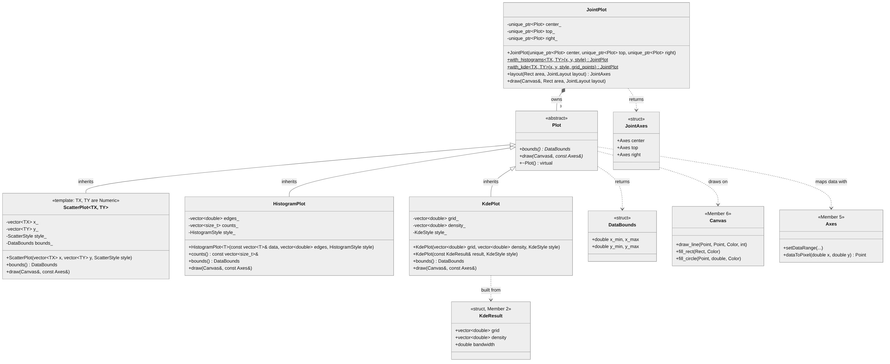

# UML: Member 4, Scatter, Histogram, KDE and Joint Plots

The source is `member4-plots.mmd` (Mermaid). To redraw the image after a change, run `mmdc -i member4-plots.mmd -o member4-plots.png -b white`.

## How to read it

- `+` is public and `-` is private. A method in *italics* is pure virtual, and an underlined method is static.
- A hollow triangle means inheritance. `ScatterPlot`, `HistogramPlot` and `KdePlot` each *is a* `Plot`.
- A filled diamond means composition. `JointPlot` *owns* three `Plot`s through `std::unique_ptr<Plot>`, and they are destroyed with it.
- A dashed arrow means "uses". A plot draws on Member 6's `Canvas`, maps data to pixels with Member 5's `Axes`, and `KdePlot` can be built from Member 2's `KdeResult`.

## Relations

- **Inheritance and polymorphism.** `Plot` is abstract: `bounds()` and `draw()` are pure virtual, and the destructor is virtual. `JointPlot::draw()` calls `draw()` on each panel without knowing which kind of plot it is, so histogram margins and KDE margins use the same `JointPlot` code.
- **Composition.** `JointPlot` holds exactly 3 plots: the centre, the top margin and the right margin.
- **Templates.** `ScatterPlot<TX, TY>` is a class template, because it keeps its data. x and y can be any `vizlib::Numeric` type, even two different ones. `HistogramPlot` only keeps bin edges and counts, so only its constructor is a template. `with_histograms` and `with_kde` are static function templates. A `ScatterPlot<int, float>` is still a `Plot`, so templates (types chosen at compile time) and virtual functions (plot kind chosen at run time) work together.
- **Encapsulation.** Every data member is private and is checked in the constructor, so a plot object that exists can always be drawn.
