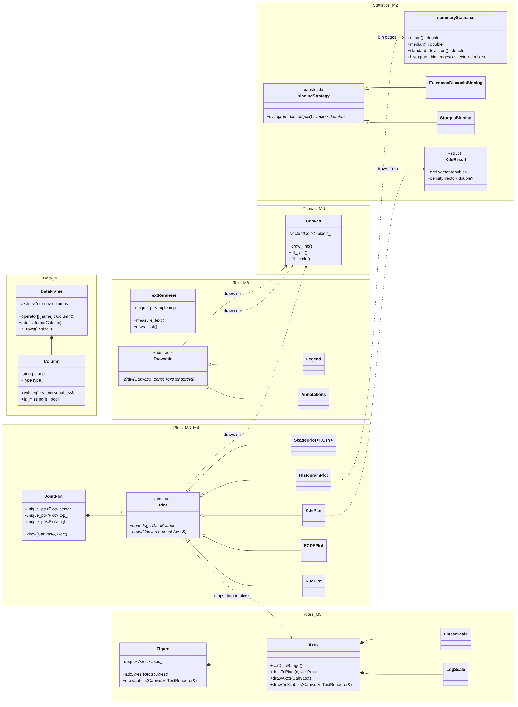

# vizlib: class diagram of the whole library

Source: `vizlib-library.mmd` (Mermaid). Each box is one module, with its owner's member number (M1 to M8). Member 7's image export has no classes, only functions, so it is not shown.

How to read it:

- A hollow triangle is **inheritance**. `ScatterPlot`, `HistogramPlot`, `KdePlot`, `ECDFPlot` and `RugPlot` are all a `Plot`. `Legend` and `Annotations` are a `Drawable`. `FreedmanDiaconisBinning` and `SturgesBinning` are a `binningStrategy`.
- A filled diamond is **composition**: the owner holds the part. A `DataFrame` holds its `Column`s, a `Figure` holds its `Axes`, an `Axes` holds its scales, and a `JointPlot` holds 3 `Plot`s through `unique_ptr`.
- A dotted arrow means **uses**. Every plot maps its data with an `Axes` and draws on the `Canvas`.
- `Plot`, `Drawable` and `binningStrategy` are abstract classes, so code can hold any plot (or any legend or note, or any binning rule) through a base pointer. That is runtime polymorphism.
- `ScatterPlot<TX, TY>` is the only class template, because it is the only class that keeps the user's data in its own type. Member 4's detailed diagram is in `member4-plots.md`, and Member 8's in `week-04-class-diagram.md`.

Drawn on 5 November by Member 4 with Claude Code, from the headers in `include/vizlib/`.
